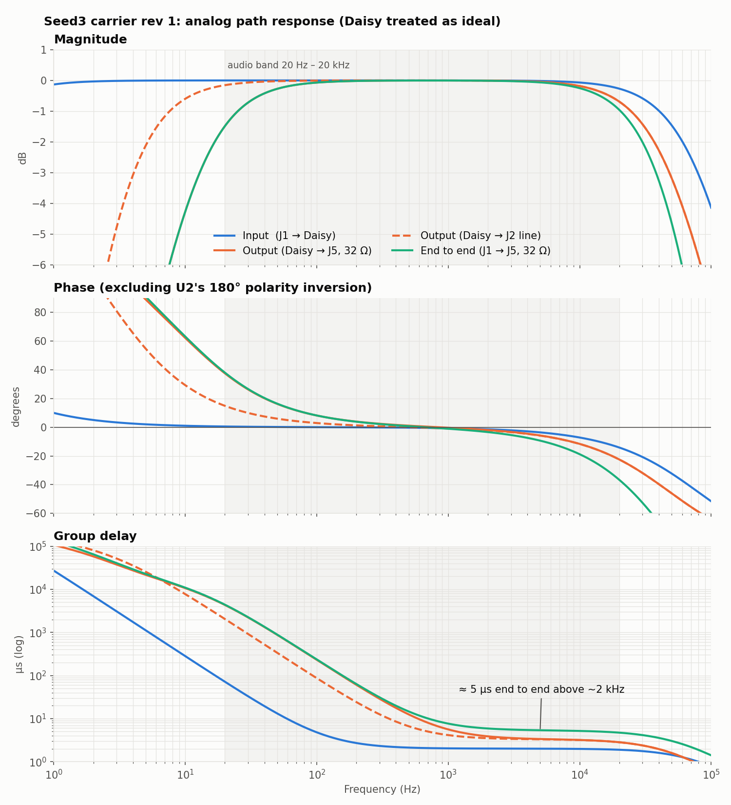
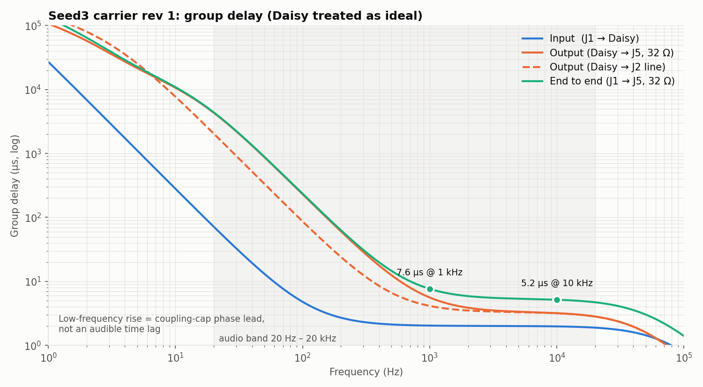

# Signal-path phase and delay

**Board:** rev 1 (`rev1/`).

**Question:** if the Daisy Seed adds no delay or phase shift, how much does the
carrier board's own analog circuitry contribute?

**Short answer:** about **5 µs** of delay end to end from 2 kHz to 20 kHz (7.6 µs at 1 kHz),
plus a **180° polarity inversion** from the headphone amp (U2). Lower down,
the output coupling capacitors dominate: phase lead grows from about 8° at 100 Hz to
about 38° at 20 Hz. For comparison, the Daisy's codec filters and audio block buffer add
roughly 1–2 ms, several hundred times more.

Group delay on its own, with the end-to-end value marked at 1 kHz and 10 kHz:

## Method

Netlist exported from `rev1/seed3-carrier.kicad_sch` and component values taken from
`rev1/fabrication/seed3-carrier-BOM.csv`. Each RC or op-amp stage is modelled as a
first-order section. The Daisy is treated as an ideal wire: zero output
impedance, no delay. `phase_response.py` computes the result and writes both
figures (`phase_response.png` and `group_delay.png`).

## One response or two?

There are two physically separate circuits. The Daisy sits between them and
isolates them: U1A drives the codec input from a low impedance, the codec output
drives R2 from a low impedance, and the signal is digital in between, so neither
half loads the other. Each half can therefore be measured on its own through the
J6 breakout with the Daisy removed (post-assembly test plan, stages 3A and 3B).

While the firmware is linear (passthrough, EQ, delay), the two halves combine
into one end-to-end response, H_total = H_in · H_Daisy · H_out. Magnitudes multiply
(dB add), and phases and group delays add. If the firmware is nonlinear
(distortion, compression, modulation), there is no single end-to-end response.
The two halves then describe what the algorithm receives and how its output is
shaped.

## Stages

### Input (J1 → AUDIO_IN_1)

| Stage | Corner | Effect |
|---|---|---|
| C3 (1 µF) into RV1 ‖ (R1 + R5) ≈ 0.9 MΩ | 0.175 Hz high-pass | +0.5° at 20 Hz |
| RV1 wiper Thevenin + R1 into U1A input capacitance (~8 pF, **estimated**) | ~80 kHz low-pass at mid travel | ≈ 2 µs; −7° at 10 kHz, −14° at 20 kHz |
| U1A follower (TLV9062, 10 MHz GBW) | ~10 MHz | ≈ 16 ns, negligible |
| C1 (100 pF shunt) | Interacts with guitar pickup and cable inductance | None with a low-impedance source |

### Output (AUDIO_OUT_1 → J5 / J2)

| Stage | Corner | Effect |
|---|---|---|
| R2 / C2 (3.3 k / 1 nF) | 48.2 kHz low-pass | ≈ 3 µs; −22° at 20 kHz |
| C5 / R6 coupling | 0.16 Hz | Negligible |
| C12 / R9 (4.7 µF / 20 k) into U2 | 1.7 Hz high-pass | Slight low-frequency lead |
| U2 inverting, gain −1 | — | **180° polarity inversion** |
| C14/C15 (470 µF) into load ‖ R13/R14 (100 Ω) | 12.6 Hz with 32 Ω phones; 3.4 Hz on the J2 line out | Main low-frequency phase source |

### Results (phase excludes the 180° inversion)

| Freq | Input | Output, 32 Ω HP | Output, J2 line | Group delay, end to end (HP) |
|---|---|---|---|---|
| 20 Hz | +0.5° | +37.5° (−1.5 dB) | +14.9° | 4.4 ms* |
| 100 Hz | 0.0° | +8.1° | +2.9° | 235 µs* |
| 1 kHz | −0.7° | −0.4° | −0.9° | 7.6 µs |
| 10 kHz | −7.2° | −11.6° | −11.7° | 5.2 µs |
| 20 kHz | −14.2° | −22.5° | −22.5° | 4.7 µs |

\*Large low-frequency group delays come from the coupling-capacitor high-pass
corners. They are phase lead near the corner, not an audible time lag.

## Caveats and follow-ups

- **Input low-pass estimate.** The ~80 kHz input pole assumes ~8 pF at U1A+ and
  depends on RV1's position. With RV1 near full it moves well above 100 kHz.
  It should be confirmed by measurement (test plan check 3A.5).
- **Sampling.** Above the codec's Nyquist frequency (24 kHz at 48 kHz sampling) the
  codec's anti-alias filter dominates, so the input path's high-frequency
  behaviour only matters up to there.
- **Test plan check 3B.4, low-end corner.** The test plan quotes ≈ 9 Hz into 32 Ω. That
  leaves out R13/R14 (100 Ω to GND), which sit in parallel with the load.
  Including them gives ≈ 12.6 Hz.
- **Polarity.** If the inversion matters (comparing against a dry signal, or
  mixing), negate the samples in firmware.
